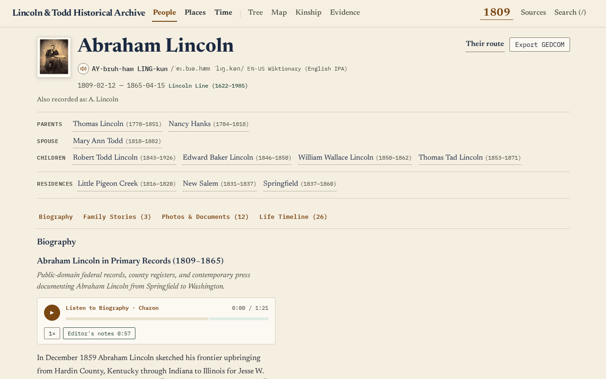

<p align="center">
  <picture>
    <source media="(prefers-color-scheme: dark)" srcset="brand/wordmark-dark.svg" />
    <source media="(prefers-color-scheme: light)" srcset="brand/wordmark-light.svg" />
    
  </picture>
</p>

<p align="center">
  <strong>Weave primary sources, places, and family memory into one living archive.</strong>
</p>

<p align="center">
  <a href="https://github.com/Tiberriver256/kinloom/actions/workflows/ci.yml"></a>
  <a href="https://tiberriver256.github.io/kinloom/"></a>
  <a href="https://www.npmjs.com/package/@kinloom/cli"></a>
  <a href="vitest.config.ts">= 90%" /></a>
  <a href="https://securityscorecards.dev/viewer/?uri=github.com/Tiberriver256/kinloom"></a>
  <a href="LICENSE"></a>
</p>

<p align="center">
  <a href="https://tiberriver256.github.io/kinloom/">
    
  </a>
</p>

Kinloom is an open-source, self-hosted family history wiki built for relatives and family archivists who want their stories anchored in primary records rather than locked inside commercial subscription sites. It keeps living relatives private by default while letting enrolled family members explore, cite, and collaboratively edit generations of people, places, maps, and historical documents.

## Live demo & visual tour

Explore the live public-domain demo archive at **[tiberriver256.github.io/kinloom](https://tiberriver256.github.io/kinloom/)** (10 generations of the Lincoln, Todd, Hanks, and Harlan families with verified photographs and NARA record scans).

<table>
  <tr>
    <td width="50%">
      
      <p><strong>People Directory.</strong> Era-grouped family directory with instant search, branch filters, AAA Dark Mode, and GEDCOM 7 export.</p>
    </td>
    <td width="50%">
      
      <p><strong>Family Tree.</strong> Zoomable multi-generation pedigree chart, Kinship Loom overview, direct-line framing, and accessible list view.</p>
    </td>
  </tr>
  <tr>
    <td width="50%">
      
      <p><strong>Migration Map &amp; Places Directory.</strong> Era-filtered residence routes on OpenHistoricalMap paired with regional place histories.</p>
    </td>
    <td width="50%">
      
      <p><strong>Person Profile.</strong> Cited life timeline, Folio Marginalia, portrait mat, primary-source reader, and collaborative revision history.</p>
    </td>
  </tr>
</table>

### Core archive capabilities

- **Collaborative archival editing:** Inline editing with `Cited` vs. `Family memory` badges, Talk discussions, Research Field Reports (`/changes`), and one-click revision or batch revert.
- **Built-in living-person privacy:**
  - Living relatives (explicit `is_living: true` or born within the living-cutoff window without a death date) have portraits, exact birth dates, and addresses stripped automatically.
  - Public builds and GEDCOM 7 exports redact living individuals completely across directories, narratives, timelines, and Open Graph cards.
  - Uploading or attaching media to a living person is blocked in the UI and rejected by the server before any bytes touch object storage.
- **Accessible by design:** Paper &amp; Ink light and dark themes verified to WCAG 2.2 AAA contrast (`npm run check:contrast`), keyboard-first Command Bar (`/` or `Cmd/Ctrl+K`), and heirloom print stylesheets.

## Built-in plugins (opt-in, off by default)

Extend any private archive without forking core packages. Every built-in plugin ships typed configuration, Admin Settings integration, and in-app documentation:

| Plugin | What it adds | Surface | Guide |
| --- | --- | --- | --- |
| **Family Recipes** | Heirloom recipe box with card scans, ancestor attribution, favorites, and threaded family comments. | UI, Server | [Plugin authoring](docs/developers/plugin-authoring.md) |
| **Narrative Audio** | Spoken family biographies with a persistent playback dock and narrated Editor's Notes. | UI, CLI | [Colab GPU TTS](docs/colab-gpu-tts.md) |
| **Pronunciation Guide** | Canonical surname and place IPA/phonetic lexicon with cached neural TTS audio clips. | UI, Server, CLI | [Plugin settings](docs/plugin-settings.md) |
| **Book Publishing** | Print-ready archival hardcover PDF compilation with mandatory living-person privacy gating and Lulu Print API export. | UI, Server, CLI | [Book Publishing](docs/book-publishing.md) |
| **Open Finance** | Transparent archive operating-cost ledger and allowlisted zero-custody family donation links. | UI, Server | [Open Finance](docs/open-finance.md) |
| **Page Visit Stats** | Cookieless, IP-free aggregate readership counts for deceased people, places, and narratives. | UI, Server | [Observability](docs/observability.md) |
| **Workers Observability** | Structured JSON request logs, `Server-Timing` spans (`d1`, `r2`, `bundle`), and synthetic `kinloom probe` checks. | Server, CLI | [Observability](docs/observability.md) |
| **Security Telemetry** | Structured auth, CSRF, RBAC, and media-rejection security event logging and alerting hooks. | Server | [Observability](docs/observability.md) |
| **Cloudflare Web Analytics** | Lightweight RUM beacon injection with automatic `/privacy` disclosure. | Server | [Observability](docs/observability.md) |

## Quickstart & self-hosting

Launch a private family archive on Cloudflare Workers (D1 + R2) in three commands:

```bash
# 1. Scaffold kinloom.config.yaml, starter YAML records, and Wrangler config
npx kinloom init my-family-archive --family-name "Alder Family" --title "Alder Family Archive"

# 2. Seed the archive database from YAML (or slice a GEDCOM first with `npx kinloom slice-gedcom`)
npx kinloom seed --site https://archive.example.org --token "$KINLOOM_AGENT_TOKEN" --data ./data

# 3. Deploy the Cloudflare Worker and static SPA bundle
npx wrangler deploy
```

For full production setup, authentication, invites, and operations, see the **Admin Documentation**:
[Installation](docs/admin/installation.md) · [Configuration](docs/admin/configuration.md) · [Access &amp; Privacy](docs/admin/access-and-privacy.md) · [Operations](docs/admin/operations.md) · [Troubleshooting](docs/admin/troubleshooting.md) · [All Docs](docs/README.md)

## Developers, CLI & plugin authors

Kinloom is a six-workspace TypeScript monorepo with a strict unidirectional dependency graph and a zero-Cloudflare portable HTTP core:

| Package | Role |
| --- | --- |
| `@kinloom/tokens` | Paper &amp; Ink DTCG design tokens (`Newsreader` + `IBM Plex Mono`), WCAG 2.2 AAA verified. |
| `@kinloom/core` | Domain schemas, EDTF dates, living-person privacy filter, GEDCOM 7 import/export, and incremental bundle patching. |
| `@kinloom/server` | Portable Web-Fetch HTTP router, auth/invites/RBAC, revision ledger, byte-range media streaming, and `KinloomServerPlugin`. |
| `@kinloom/worker` | Thin Cloudflare Workers adapter binding `@kinloom/server` to D1 SQLite and R2 object storage. |
| `@kinloom/ui` | Capability-driven React 19 archive explorer, wiki editors, Admin hub, and `KinloomUiPlugin` slots. |
| `@kinloom/cli` | Pure-TypeScript operator &amp; research CLI: lifecycle (`init`, `seed`, `sync`, `export-yaml`), 23 archival/OCR/audio commands (`nara`, `chronam`, `findagrave`, `prep-scan`, `ocr`, `narrative-audio`), and 26 embedded guides (`kinloom guide`). |

Dive deeper in the developer documentation:
[Architecture](docs/developers/architecture.md) · [Plugin Authoring](docs/developers/plugin-authoring.md) · [Testing &amp; Publishing Plugins](docs/developers/testing-and-publishing-plugins.md) · [Design System](DESIGN.md) · [Ubiquitous Language](docs/ubiquitous-language.md)

### Local development & verification

```bash
npm ci
npm run check         # architecture, lint, build, typecheck, Vitest, WCAG contrast, leak & docs checks
npm run test:coverage # enforce >= 90% V8 statements, branches, functions, and lines
npm run test:e2e      # Chromium Playwright suite (static demo and live wiki)
```

## Community & license

- **Contributing:** [CONTRIBUTING.md](CONTRIBUTING.md) · **Support:** [SUPPORT.md](SUPPORT.md) &amp; [GitHub Discussions](https://github.com/Tiberriver256/kinloom/discussions)
- **Security &amp; privacy:** [SECURITY.md](SECURITY.md) · **Code of conduct:** [CODE_OF_CONDUCT.md](CODE_OF_CONDUCT.md)
- **License:** MIT — see [LICENSE](LICENSE).
