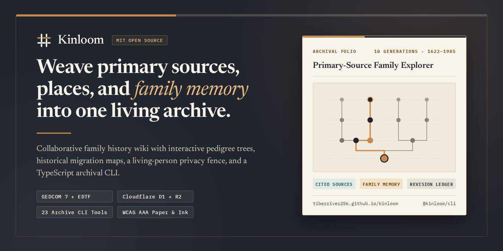
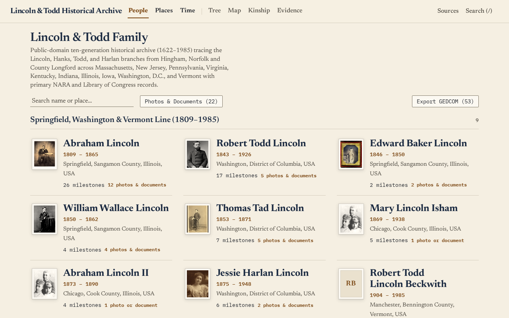
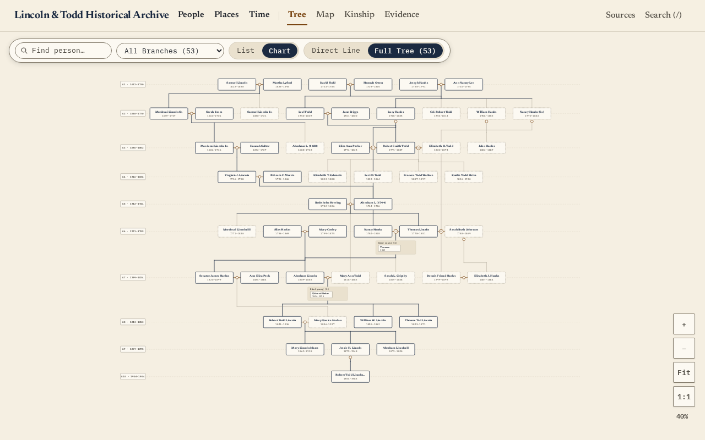
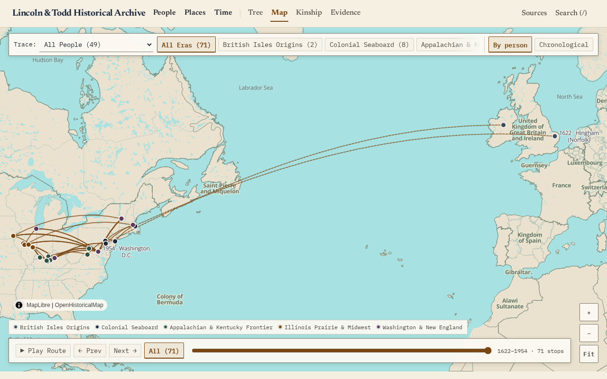

<p align="center">
  <picture>
    <source media="(prefers-color-scheme: dark)" srcset="brand/wordmark-dark.svg" />
    <source media="(prefers-color-scheme: light)" srcset="brand/wordmark-light.svg" />
    
  </picture>
</p>

<p align="center">
  <strong>Weave primary sources, places, and family memory into one living archive.</strong>
</p>

<p align="center">
  <a href="https://github.com/Tiberriver256/kinloom/actions/workflows/ci.yml"></a>
  <a href="https://tiberriver256.github.io/kinloom/"></a>
  <a href="https://www.npmjs.com/package/@kinloom/cli"></a>
  <a href="vitest.config.ts">= 90%" /></a>
  <a href="https://securityscorecards.dev/viewer/?uri=github.com/Tiberriver256/kinloom"></a>
  <a href="LICENSE"></a>
</p>

<p align="center">
  <a href="https://tiberriver256.github.io/kinloom/">
    
  </a>
</p>

Kinloom is an open-source MIT framework for private, collaborative family history wikis grounded in primary archival records. Families explore people, places, timelines, maps, kinship graphs, and primary source transcriptions inside one web application while editing records with append-only revision history, optimistic conflict resolution, and one-click revert.

## Live public demo

Browse the live demo archive at [https://tiberriver256.github.io/kinloom/](https://tiberriver256.github.io/kinloom/).

The demo publishes a 54-person, 10-generation public-domain archive (1622-1985) covering the Lincoln, Todd, Hanks, and Harlan branches across Massachusetts, New Jersey, Pennsylvania, Virginia, Kentucky, Indiana, Illinois, Iowa, Washington, D.C., and Vermont. It includes 35 verified public-domain photographs and NARA record scans, plus one synthetic living test fixture that verifies public redaction.

## Visual tour

All screenshots below come directly from the public-domain Lincoln and Todd demo in `examples/demo/`.

<table>
  <tr>
    <td width="50%">
      
      <p><strong>Archive index.</strong> White-labeled family landing page with search, photo filters, GEDCOM 7 export, and living-person redaction.</p>
    </td>
    <td width="50%">
      
      <p><strong>Interactive family tree.</strong> Ten-generation zoomable pedigree chart with direct-line framing, branch filters, and list view.</p>
    </td>
  </tr>
  <tr>
    <td width="50%">
      
      <p><strong>Historical migration map.</strong> Era-filtered residence routes plotted on OpenHistoricalMap with step-by-step chronological playback.</p>
    </td>
    <td width="50%">
      
      <p><strong>Person dossier.</strong> Primary-source life timeline, portrait mat, residence history, family relationships, and cited archival records.</p>
    </td>
  </tr>
</table>

## Quickstart

Launch a family archive in three commands:

```bash
# 1. Scaffold kinloom.config.yaml, starter YAML records, and Wrangler config
npx kinloom init my-family-archive --family-name "Alder Family" --title "Alder Family Archive"

# 2. Seed the archive database from YAML (or slice an existing GEDCOM first with `npx kinloom slice-gedcom`)
npx kinloom seed --site https://archive.example.org --token "$KINLOOM_AGENT_TOKEN" --data ./data

# 3. Deploy the Cloudflare Worker and static SPA bundle
npx wrangler deploy
```

## Documentation

Browse the full [documentation hub](docs/README.md) or jump directly to a guide:

| Audience | Guide | Summary |
| --- | --- | --- |
| All readers | [Documentation hub](docs/README.md) | Central index of developer, plugin, operational, and historical docs. |
| Contributors | [Architecture](docs/developers/architecture.md) | Six-package DAG, hexagonal ports, incremental bundle patching, XState v5, dark mode tokens, and CI invariants. |
| Plugin authors | [Plugin authoring guide](docs/developers/plugin-authoring.md) | Build plugins across Server, Worker, UI, and CLI with settings schemas, scoped SQL migrations, and named UI slots. |
| Plugin authors | [Testing and publishing plugins](docs/developers/testing-and-publishing-plugins.md) | InMemory and Miniflare D1/R2 parity tests, RBAC/CSRF/SQL checks, npm subpath exports, and privacy checklist. |
| Plugin authors | [Declarative plugin settings](docs/plugin-settings.md) | Typed `settingsSchema` fields, write-only secrets, and Admin Settings HTTP API. |
| Operators | [Observability and telemetry](docs/observability.md) | Workers telemetry, security events, WAF rules, `kinloom probe`, and Page Visit Stats. |
| Operators | [Optional plugins and CLI guides](docs/README.md#operational-and-optional-plugin-guides) | [Open Finance](docs/open-finance.md), [Book Publishing](docs/book-publishing.md), [UI Screenshots](docs/ui-screenshots.md), and [Colab GPU TTS](docs/colab-gpu-tts.md). |
| Designers & writers | [Design system](DESIGN.md) & [Ubiquitous language](docs/ubiquitous-language.md) | Paper & Ink AAA tokens and canonical archive vocabulary. |

## Backend modularity seam

Kinloom separates the React explorer (`<KinloomApp />`) from storage and hosting through two boundaries:

```text
<KinloomApp />
   │
   ├── StaticDemoDataSource ──────────► Static JSON files (GitHub Pages / local preview)
   │     (reports canEdit: false, hasRevisionHistory: false, hasTalk: false)
   │
   └── HttpWikiDataSource ────────────► @kinloom/server (portable Web-Fetch HTTP router)
         (reports live role capabilities)    │
                                             ├── @kinloom/worker (Cloudflare D1 + R2)
                                             ├── InMemory adapters (local tests / CI)
                                             └── Custom Node, Postgres, or S3 adapters
```

- **Capability-driven UI.** `<KinloomApp />` has no demo-mode switches. `StaticDemoDataSource.getSession()` reports an anonymous session with all write, history, talk, upload, and admin capabilities set to `false`. `HttpWikiDataSource.getSession()` reads `/api/auth/me` from the live server and enables Edit, History, Talk, Media Upload, Recent Changes, and Admin views from those capabilities.
- **Zero-Cloudflare server core.** `@kinloom/server` depends only on Web-Standard Fetch and WebCrypto primitives (`Request`, `Response`, `crypto.subtle`). `@kinloom/worker` binds `@kinloom/server` to Cloudflare D1 and R2, while tests or self-hosted deployments can swap in any adapter implementing `ArchiveRepository`, `BundleCache`, `MediaStore`, `EmailSender`, and `AuthProvider`.
- **Incremental bundle patching.** Every live write patches the compiled `ArchiveBundle` in place with `patchCompiledBundle()` in `@kinloom/core` instead of recompiling the entire archive from scratch.

## Architecture and packages

Kinloom ships six npm workspaces and a public-domain demo app:

| Package | Role | Key capabilities |
| --- | --- | --- |
| `@kinloom/tokens` | Design tokens | Paper & Ink DTCG color and typography tokens (`Newsreader` + `IBM Plex Mono`) verified to WCAG 2.2 AA and AAA via `npm run check:contrast`. |
| `@kinloom/core` | Domain engine | Typed Zod schemas, EDTF date parser, residence-span derivation, living-person privacy filter, GEDCOM 7 import/export, YAML serialization, revision diffs/reverts, and incremental `patchCompiledBundle()`. |
| `@kinloom/server` | Portable backend | Zero-Cloudflare Web-Fetch HTTP router, auth/invite/magic-link services, optimistic concurrency (`409 Conflict`), append-only revision ledger, HTTP `206 Partial Content` byte-range media streaming, `KinloomServerPlugin`, and `InMemory` test adapters. |
| `@kinloom/worker` | Cloudflare runtime | Thin adapter binding `@kinloom/server` to Cloudflare Workers, D1 SQLite migrations, R2 content-addressed media storage, and R2 incremental bundle caching. |
| `@kinloom/ui` | React 19 explorer & wiki | White-labeled People, Places, Time, Tree, Map, Kinship, and Evidence views; inline editors with `Cited` and `Family memory` badges; `409 Conflict` merge dialog; visual diffs; one-click Revert and Batch Revert; Talk threads; Media Uploader; HTML5 `<video>`/`<audio>` player; and `KinloomUiPlugin`. |
| `@kinloom/cli` | Operator & agent CLI | Pure-TypeScript CLI for archive lifecycle (`init`, `slice-gedcom`, `seed`, `submit-batch`, `export-yaml`, `sync`, `migrate`), archive operations (`context`, `integrate`, `audit`, `verify`, `pronounce`), 23 built-in archival, scan-prep, OCR, and narrative-audio commands, and 26 embedded workflow guides (`kinloom guide`). |

## Typed plugin seam and rich media

Private sites extend Kinloom without forking core packages:

- **`KinloomUiPlugin` (`@kinloom/ui`).** Register custom routes and top-bar/footer links, inject React panels into named page slots (`indexHero`, `personDetail`, `placeDetail`, `sourceReaderFooter`, `evidenceExtra`, `topBarNav`, `footer`, `adminSettings`), provide custom `mediaRenderers`, opt into open-cost transparency with `createOpenFinancePlugin()` (off by default; see [docs/open-finance.md](docs/open-finance.md)), or enable admin-only archival hardcover book publishing with `createBookPublishingPlugin()` (off by default; see [docs/book-publishing.md](docs/book-publishing.md)).
- **`KinloomServerPlugin` (`@kinloom/server`).** Mount authenticated custom API routes that inherit session, RBAC, and CSRF enforcement, subscribe to `onRevisionCommitted` hooks, opt into request lifecycle telemetry with `createWorkersObservabilityPlugin()` (off by default; see [docs/observability.md](docs/observability.md)), enable open-cost transparency and allowlisted donations with `createOpenFinancePlugin()` (off by default; see [docs/open-finance.md](docs/open-finance.md)), or enable landscape hardcover book PDF export and Lulu Print API fulfillment with `createBookPublishingServerPlugin()` (off by default; see [docs/book-publishing.md](docs/book-publishing.md)).
- **`KinloomCliPlugin` (`@kinloom/cli`).** Auto-discovered from `extensions/<name>/cli.mjs` or `kinloom.config.yaml` (`plugins`). Plugins can register custom subcommands (such as the opt-in `createBookPublishingCliPlugin()` for `kinloom book build|quote|submit|status`; see [docs/book-publishing.md](docs/book-publishing.md)), `auditChecks` for `kinloom audit`, and `verifyChecks` for `kinloom verify` (including check-only plugins without custom commands):

```js
/** @type {import('@kinloom/cli').KinloomCliPlugin} */
export default {
  id: 'site-quality-checks',
  name: 'Site Quality Checks',
  auditChecks: [
    {
      id: 'require-custom-note',
      name: 'Custom Note Check',
      run: ({ patch }) => ({
        errors: [],
        warnings: patch.notes ? [] : ['Staged patch is missing a custom research note.'],
      }),
    },
  ],
  verifyChecks: [
    {
      id: 'require-places',
      name: 'Place Count Check',
      run: ({ places }) => ({
        errors: places.length > 0 ? [] : ['Archive must define at least one place.'],
        warnings: [],
      }),
    },
  ],
};
```

- **Byte-range video and oral histories.** `MediaService` validates and stores images, PDFs, MP4/WebM videos, and audio oral histories under content-addressed SHA-256 keys, streaming `GET /media/:key` with HTTP `206 Partial Content` and `Content-Range` headers for scrubbable `<video>` and `<audio>` playback.

## Built-in genealogy research CLI and guides

`@kinloom/cli` ships 23 pure-TypeScript archival, scan-prep, OCR, and narrative-audio commands plus 26 embedded workflow guides (`kinloom guide`), with no Python or external package manager required:

- **Federal and general archives.** `nara`, `archive-org` (alias `ia`), `chronam`, `hathi`, `findagrave`, `gnis`, `wikitree`, `persi`
- **State archives.** `ca-archives`, `ky-archives`, `michiganology`, `mn-archives`, `mo-archives`, `nj-archives`, `texas-archives`, `va-archives`
- **International archives.** `fi-archives`, `openarchieven`, `se-archives`, `uk-archives`
- **Media, scan prep, and OCR.** `prep-scan`, `ocr`, `narrative-audio`
- **Embedded research guides.** `kinloom guide` (including `blm-glo`, `cyndis-list`, `pronounce`, and `narrative-audio/script-rules`)

Agents submit structured multi-entity discoveries through `POST /api/batches` with scoped `write_batch` bearer tokens. Every agent wave appears in `/changes` with a `Research agent` badge and supports one-click reverse-order Batch Revert.

## Living-person privacy policy

Kinloom enforces living-person privacy in both `@kinloom/core` and `@kinloom/server`:

- Any person marked `is_living: true` (or with no death date and a birth year inside the configured living-cutoff window, 101 years by default) has portraits, exact birth dates, street addresses, and residence spans stripped at write and compile time.
- Public builds redact living individuals completely from people lists, narratives, event summaries, and GEDCOM 7 exports.
- Attempting to upload or attach a portrait or photo to a living person is blocked in the uploader UI and rejected by the server with HTTP `422` (`LIVING_MEDIA_FORBIDDEN`) before any file bytes are written to object storage.

## Development and verification

```bash
npm ci
npm run check         # check:arch, Biome, build all 6 workspaces, typecheck, Vitest, WCAG contrast, leak check
npm run test:coverage # enforce >= 90% V8 line, function, statement, and branch coverage
npm run test:e2e      # Chromium Playwright suite covering static demo and live wiki flows
```

## Community and governance

- **Contributing.** Read [CONTRIBUTING.md](CONTRIBUTING.md) for local setup, architecture invariants, and pull request checks.
- **Support and discussions.** Ask setup questions or share custom plugins in [GitHub Discussions](https://github.com/Tiberriver256/kinloom/discussions) or read [SUPPORT.md](SUPPORT.md).
- **Security and privacy.** Report vulnerabilities privately through [SECURITY.md](SECURITY.md) instead of public issues.
- **Code of conduct.** All contributors follow [CODE_OF_CONDUCT.md](CODE_OF_CONDUCT.md).
- **Design system.** Review Paper & Ink tokens and WCAG AAA rules in [DESIGN.md](DESIGN.md).

## License

MIT. See [LICENSE](LICENSE).
